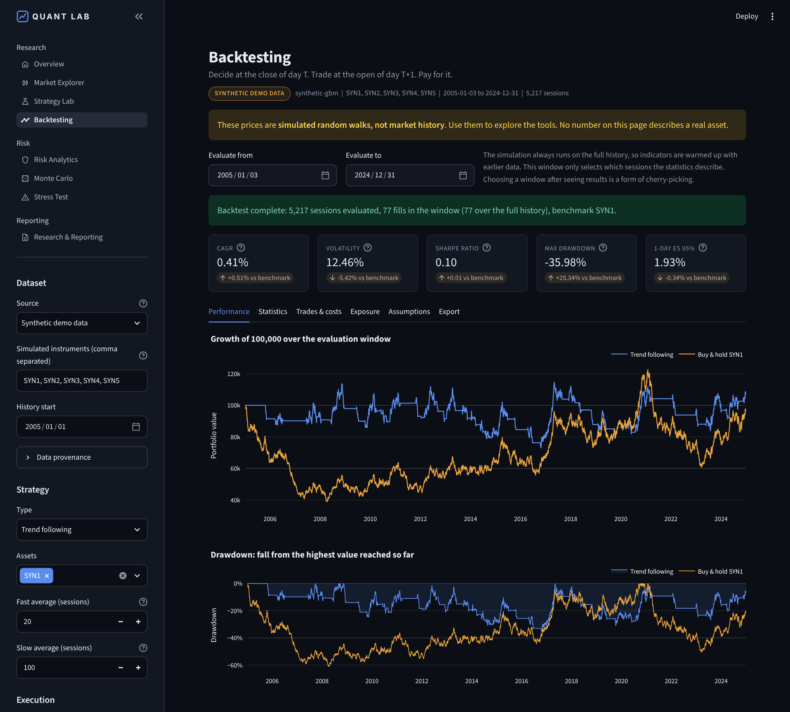
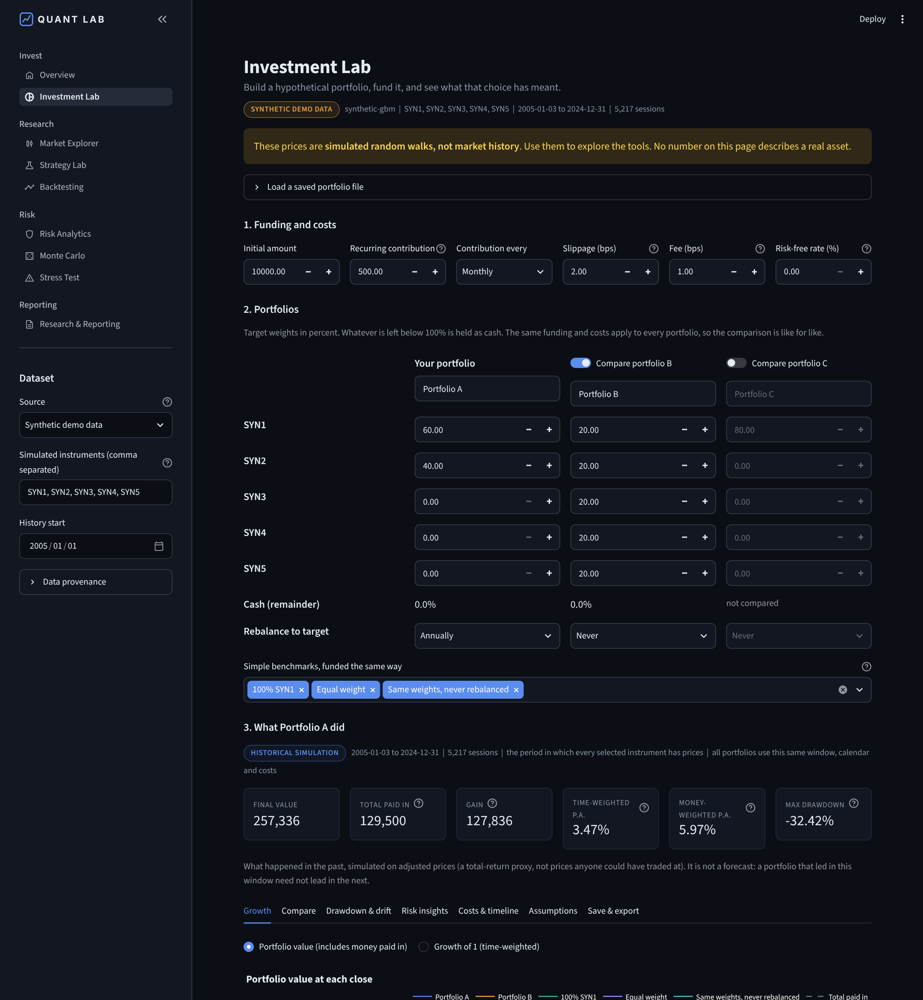
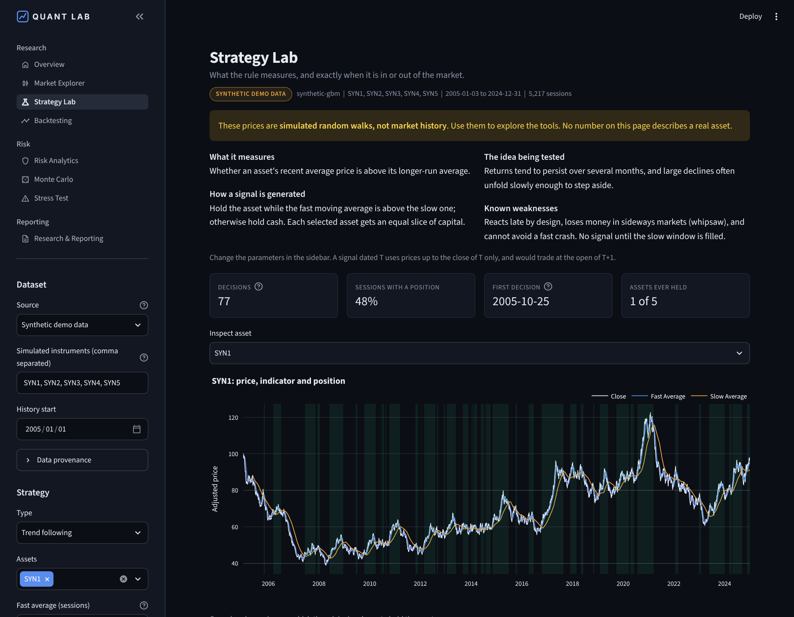
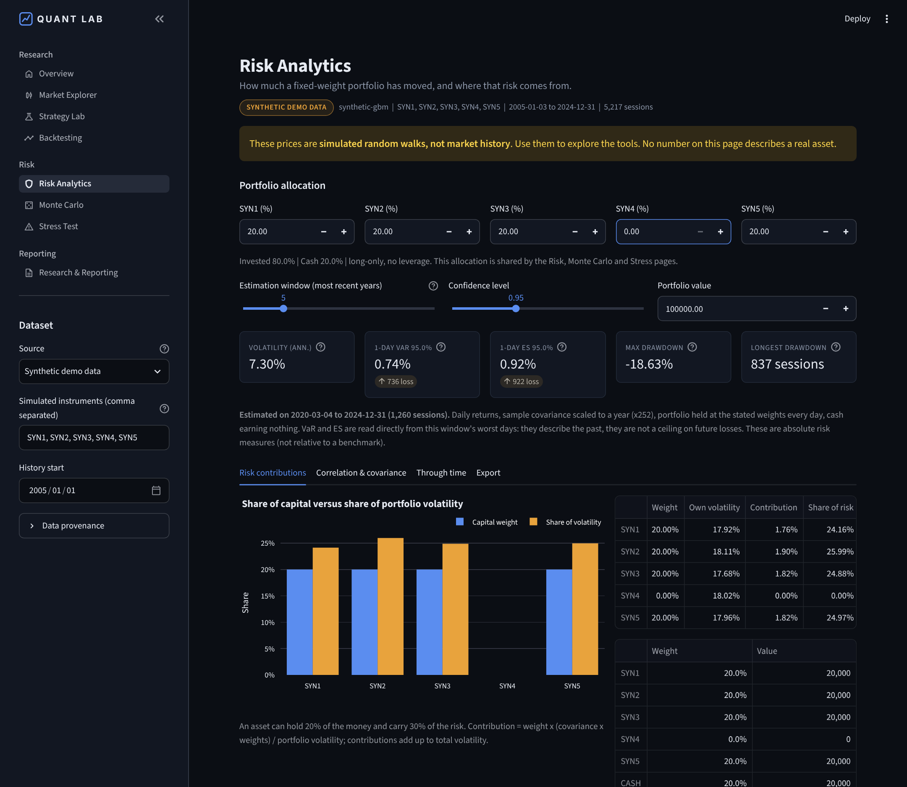
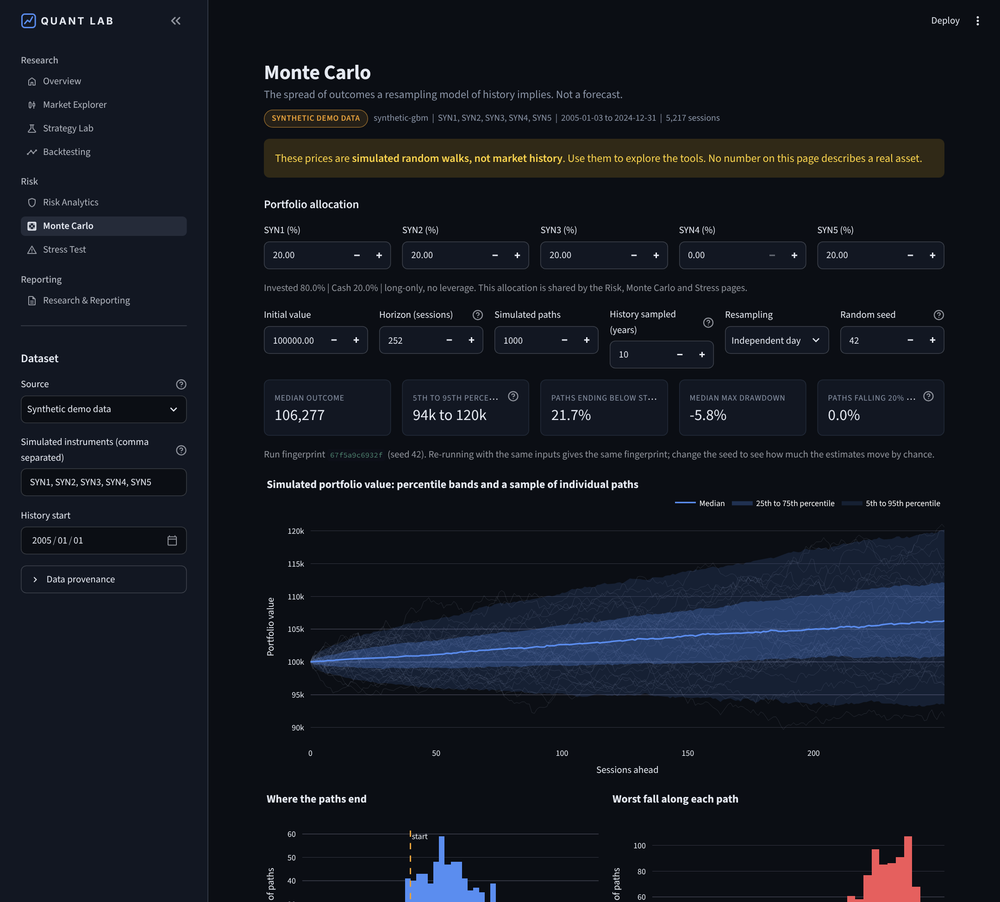

# Quant Lab

**Systematic Research. Measurable Risk. Reproducible Results.**

**Live demo:** [quantlab-kriti.streamlit.app](https://quantlab-kriti.streamlit.app/) (synthetic demo data only)

A quantitative research platform in Python: a backtesting engine that cannot
look ahead, performance and risk analytics, Monte Carlo simulation, statistical
validation, and a dashboard on top. Built to answer one question properly
rather than to produce attractive equity curves.



## Why it exists

Most retail backtests are wrong in the same few ways: they trade at prices they
have already seen, ignore costs, tune parameters on the data they are judged
on, and report a point estimate with no uncertainty. Quant Lab is an attempt to
do the opposite on a small scale, and to show the evidence: every numerical
claim in this repository is backed by a test or a reproducible record.

## What it does

| Capability | Detail |
|---|---|
| **Investment Lab** | Build up to three hypothetical portfolios (weights, cash, contributions, rebalancing, costs), compare them with simple benchmarks on one shared window, and see time- and money-weighted returns, drawdown, drift and risk; save and reload portfolio files |
| **Future Wealth** | Inside the Investment Lab: a funded plan (starting amount, growing monthly contributions, allocation, rebalancing, costs, fees, cash yield, inflation) simulated forward month by month under four joint return models; goal probabilities (reach vs hold), required contributions, deposits vs growth, downside and crash scenarios, plan comparisons on common random numbers, model sensitivity, walk-forward validation and an append-only forecast record. Not a forecast; see [docs/forecasting.md](docs/forecasting.md) |
| **Research Copilot** | Read-only MCP server (`python -m quantlab.copilot.server`, configured in `.mcp.json`) that lets Claude answer plan and model questions with the validated tools, with provenance and reproducible result hashes; see [docs/copilot.md](docs/copilot.md) |
| **Backtesting** | Signals at the close of day T fill at the open of T+1, with slippage and fees; long-only cash account; full trade ledger |
| **Strategies** | Trend following (moving-average crossover), z-score mean reversion, cross-sectional momentum, buy and hold |
| **Performance** | CAGR, volatility, Sharpe, Sortino, drawdown depth and length, Calmar, beta, alpha, tracking error, information ratio, turnover |
| **Risk** | Covariance, volatility, historical VaR and expected shortfall, risk contributions, hypothetical stress tests |
| **Simulation** | Seeded bootstrap Monte Carlo: independent days, fixed blocks, or random-length blocks |
| **Validation** | Chronological splits, parameter and cost sensitivity, paired block-bootstrap intervals, trial counting, Bonferroni and Holm |
| **Data freshness and refresh** | Exchange-calendar-aware detection of the last completed session; the provider is contacted only when a completed session is missing, with back-off, a manual refresh, atomic verified caching and honest outcome reporting |
| **Reproducibility** | Experiment records with config hash, data checksums, package versions and git commit; `--verify` re-runs and compares |
| **Dashboard** | Nine pages, four clearly labelled data sources, CSV / JSON / HTML exports |

## Screenshots

Real captures of the running app in its **synthetic demo mode** (simulated
instruments SYN1 to SYN5, labelled on every page).

| | |
|---|---|
|  |  |
|  |  |

## Quick start

Requires Python 3.11, 3.12 or 3.13. macOS notes: [docs/MACOS.md](docs/MACOS.md).

```bash
git clone <repository-url> quant-lab && cd quant-lab
python3 -m venv .venv && source .venv/bin/activate
pip install -e ".[data,app,dev]"
```

### Run the dashboard

```bash
streamlit run app/main.py          # opens http://localhost:8501
```

Choose a data source in the sidebar: live Yahoo Finance, your own CSV files
(two sample files are in `examples/sample_data/`), or **Synthetic demo data**,
which needs no internet connection and is labelled as simulated on every page.
A five-minute guided tour: [docs/DEMO.md](docs/DEMO.md).

### Use the engine from Python

```python
from quantlab.data import SyntheticProvider          # or YFinanceProvider, CsvProvider
from quantlab.strategies import TrendFollowing, BuyAndHold
from quantlab.backtesting import backtest_strategy
from quantlab.execution import ExecutionConfig
from quantlab.analytics import performance_summary

data = SyntheticProvider(seed=1).fetch(["SPY"], "2012-01-01", "2023-12-29")
cfg = ExecutionConfig(initial_capital=100_000, slippage_bps=2, fee_bps=1)
trend = backtest_strategy(TrendFollowing(50, 200), data, cfg)
bench = backtest_strategy(BuyAndHold({"SPY": 1.0}), data, cfg)
print(performance_summary(trend.returns, bench.returns))
print(trend.trades.head())          # every fill is dated after its decision
```

`python examples/quickstart.py` runs a longer version.

## Architecture

```
src/quantlab/            the library; no dependency on the dashboard
  data/          providers (Yahoo, CSV, synthetic, cache), validation, transforms
  strategies/    market data -> dated target weights; never see cash or P&L
  execution/     cost model; order sizing under the cash constraint
  portfolio/     cash and holdings ledger; refuses overdrafts and oversells
  backtesting/   the open / close event loop
  analytics/     performance statistics, each with a written definition
  risk/          covariance, VaR, expected shortfall, contributions, stress
  simulations/   bootstrap Monte Carlo
  research/      splits, block bootstrap, sweeps, trial registry
  reporting/     experiment records and exports
app/                     Streamlit dashboard (presentation only)
  main.py                navigation;  components/  design system and shared controls
  views/                 one file per page
experiments/             runnable studies, their records, the dataset manifest
tests/                   unit and integration tests on deterministic fixtures
docs/                    methodology, audit, data rights, deployment, learning guide
```

Data flows one way: provider -> `MarketData` -> strategy -> target weights ->
engine -> `BacktestResult` -> analytics. The core library needs only NumPy and
pandas.

## Methodology in brief

Full detail, with every formula: [docs/methodology.md](docs/methodology.md).

**Execution assumptions**

| Topic | Convention |
|---|---|
| Timing | Decide after the close of T using data dated T or earlier; fill at the open of T+1 |
| Slippage | Buys at open x (1 + s), sells at open x (1 - s) |
| Fees | Basis points of traded value, plus an optional fixed fee |
| Sizing | Target shares = weight x equity at the open / open. Sells first; buys scaled so cash never goes negative |
| Constraints | Long-only, no leverage, no shorting; cash earns nothing |
| Prices | Split- and dividend-adjusted OHLC: a total-return proxy, not traded quotes |
| Missing prices | No trade; the order waits; holdings marked at the last price and flagged |
| Invariant | At every close, equity = cash + sum(shares x close) |

**Validation approach**

- Chronological development / evaluation split; nothing is shuffled.
- Parameters are fixed before the evaluation period is examined; sensitivity
  grids use development data only (a test rewrites all later prices and checks
  the grid is unchanged).
- Uncertainty from a paired stationary block bootstrap, which keeps volatility
  clustering and the strategy / benchmark pairing.
- A small set of pre-specified metrics is tested with a Bonferroni adjustment;
  everything else is labelled exploratory.
- Every evaluation is counted.

## The research study

*Does a 50/200-day trend-following rule improve downside risk versus buy-and-hold, after
costs?* The protocol (fixed in advance, with a held-back evaluation period, cost sensitivity
and multiple-testing control) is in `experiments/trend_vs_buyhold.py`.

> Results computed on the private reference dataset are not published in this copy: redistribution
> rights for that data are not established. The code that produces them is included; run it on data
> you are licensed to use.

## Reproducibility

Every experiment writes a record: configuration and its hash, data checksums,
package versions and the git commit. Random numbers always come from an
explicit seed.

**Reproducing the study.** `python experiments/trend_vs_buyhold.py` runs the full protocol on
prices it downloads from Yahoo Finance for your own use (or `--synthetic` for an offline pipeline
check). The original reference dataset and its results are not part of this copy.

## Tests

```bash
python -m pytest -q      # 402 tests, about a minute, no network needed
ruff check .
```

| Verified on | Result |
|---|---|
| Linux, Python 3.13.18, NumPy 2.5.3, pandas 3.0.5, Streamlit 1.67.0, exchange_calendars 4.13.3 | 402 passed |
| Linux, Python 3.12, NumPy 2.5.5, pandas 3.1.1 | 402 passed |
| Linux, Python 3.11, NumPy 2.4.6, pandas 3.1.1 | 402 passed |
| GitHub Actions (ubuntu-latest), Python 3.11 / 3.12 / 3.13 | passed on the private development repository |
| macOS, Windows | **not tested** (see [docs/MACOS.md](docs/MACOS.md)) |
| Declared minimums (NumPy 1.26, pandas 2.2, Streamlit 1.50) | minimums are declared, not all tested; pandas 2.2.3 / NumPy 2.1.3 / Streamlit 1.50 passed an earlier version of the suite |

What the tests cover: hand-computed fills, cash and fees; a "rewrite the
future" test proving no look-ahead; randomized accounting invariants; an
independent reference backtest; SciPy and standard-library cross-checks of the
statistics; every dashboard page under normal and awkward inputs. A CI workflow
(`.github/workflows/ci.yml`) builds the package, lints and tests on three
Python versions without contacting any data provider.

## Data licensing and provenance

- **No market data is distributed with this project.** `examples/sample_data/`
  and the demo mode contain simulated series only.
- Live data comes from Yahoo Finance through `yfinance`, for the user's own
  personal use under Yahoo's terms. Quant Lab does not grant any rights to it.
- The study's reference dataset and every result computed from it are retained privately;
  `experiments/MANIFEST.json` identifies the dataset by checksum only.
- Bring your own licensed data through CSV files: [docs/DATA.md](docs/DATA.md).
- Third-party software notices: [NOTICE.md](NOTICE.md).

## Technology

Python 3.11+, NumPy, pandas (core library); Streamlit and Plotly (dashboard);
yfinance and exchange_calendars (optional live data and session calendar); pytest, Ruff and SciPy (development; SciPy only
as an independent cross-check in tests); GitHub Actions (CI).

## Limitations

- **Data.** Yahoo adjusted prices are unofficial, revised over time and not
  point-in-time; the exact study dataset is not public ([docs/DATA.md](docs/DATA.md)).
- **Bias.** The instruments were chosen with hindsight; closed funds are absent.
- **Sample size.** Drawdown conclusions rest on a handful of episodes.
- **Model.** Long-only, daily bars, flat costs with no market impact, no
  interest on cash, no separate dividend cash flows.
- **Statistics.** The bootstrap resamples realized returns and assumes the
  period is representative.
- Nothing here is investment advice.

## Future research

Each is a new hypothesis that would need its own protocol and fresh data.

- Trend following across uncorrelated assets, where diversification rather than timing may carry the benefit
- Faster or volatility-based exits against rapid falls
- Interest on cash and a time-varying risk-free rate
- Re-running the rule inside the bootstrap on resampled price paths
- Selection-aware statistics such as the deflated Sharpe ratio

## Licence

Source-available under the **Business Source License 1.1** ([LICENSE](LICENSE)),
(c) 2026 Kriti Mantravadi. You may read, modify and run it for non-production use, and
use it in production for personal non-commercial or academic purposes. Hosting it as a
service, selling it, embedding it in a product or using it for client work requires a
commercial licence: contact [@kmantravadi24](https://github.com/kmantravadi24). Version
0.2.0 converts to the Apache License 2.0 on 2030-11-18. Third-party notices:
[NOTICE.md](NOTICE.md).

## How it was built

Designed, directed and reviewed by Kriti Mantravadi, with AI assistance (Anthropic's
Claude, via Claude Code) used to write and test much of the code and documentation.
Every result is pinned by automated tests and independent reference implementations
rather than taken on trust.

## Documents

| | |
|---|---|
| [docs/methodology.md](docs/methodology.md) | Every convention and formula |
| [docs/forecasting.md](docs/forecasting.md) | Future Wealth: event order, return models, goal maths, validation, limitations |
| [docs/copilot.md](docs/copilot.md) | Quant Research Copilot: read-only MCP tools for Claude, safety controls, evaluation |
| [docs/FUTURE_WEALTH_REPORT.md](docs/FUTURE_WEALTH_REPORT.md) | Future Wealth implementation, tests, validation results, performance, risks |
| [docs/DATA.md](docs/DATA.md) | Data sources, rights, reproducibility manifest |
| [docs/DEPLOYMENT.md](docs/DEPLOYMENT.md) | Hosting checklist |
| [docs/MACOS.md](docs/MACOS.md) | macOS installation and verification checklist |
| [docs/DEMO.md](docs/DEMO.md) | Five-minute guided tour |
| [docs/learning_guide.md](docs/learning_guide.md) | The ideas explained from a physics background |

This project was built with substantial AI assistance (Anthropic's Claude);
the author specified, reviewed and verified the work.
